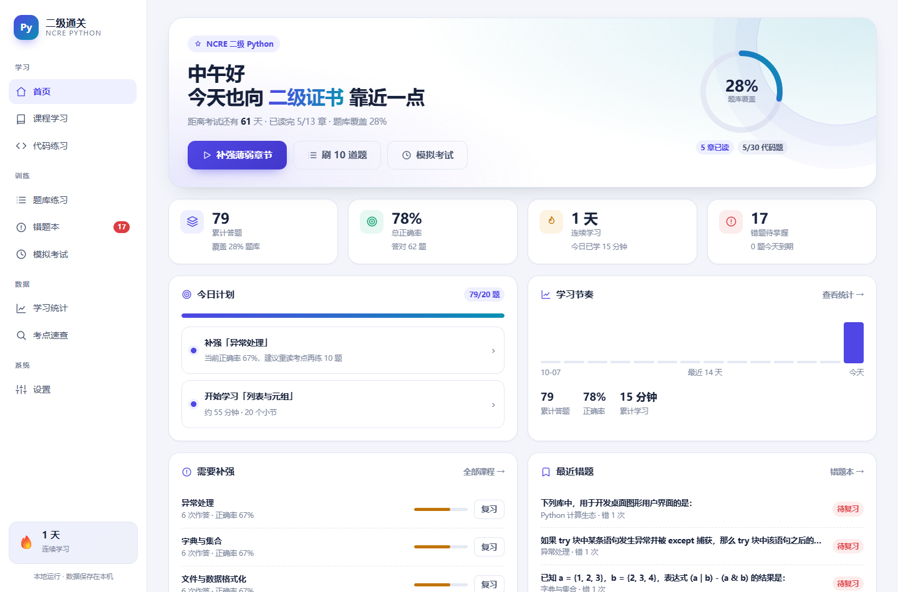
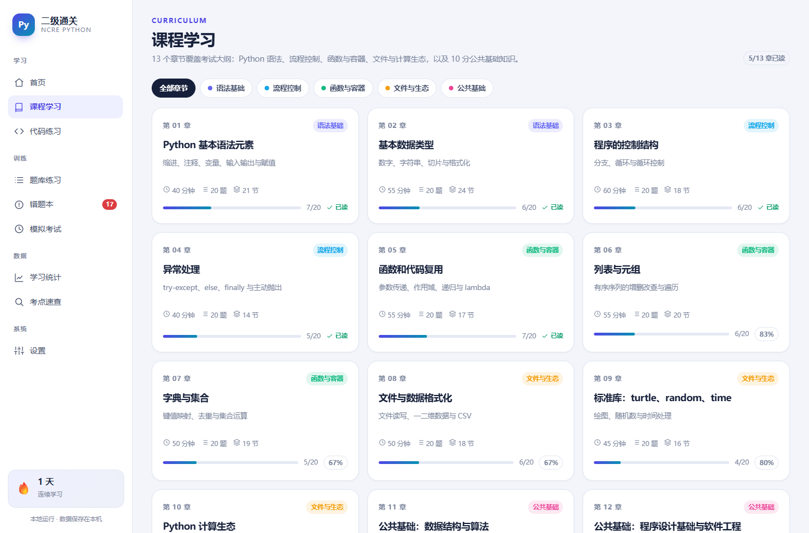
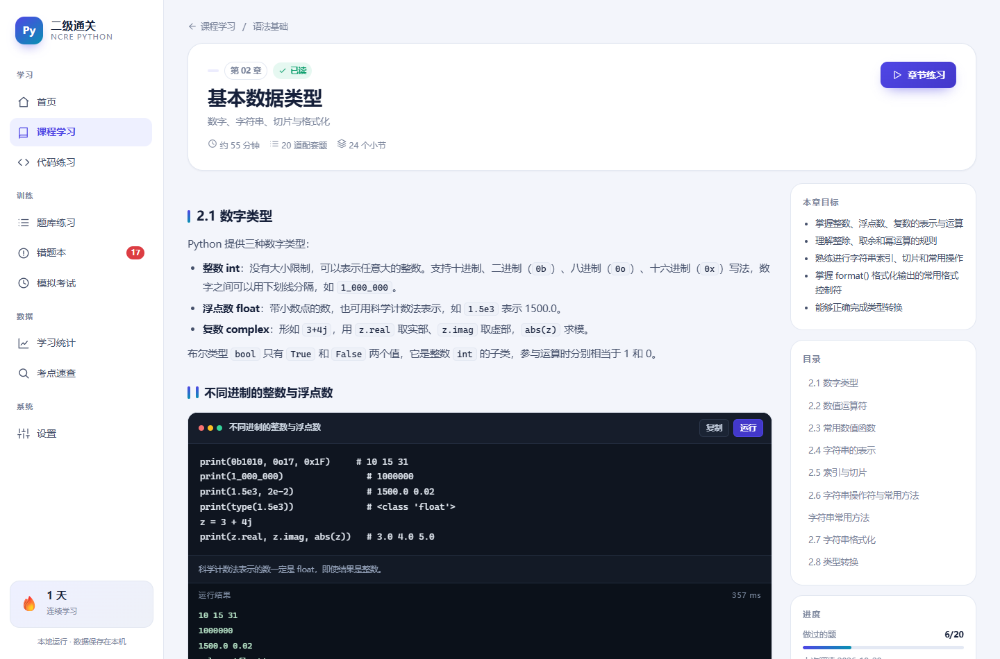
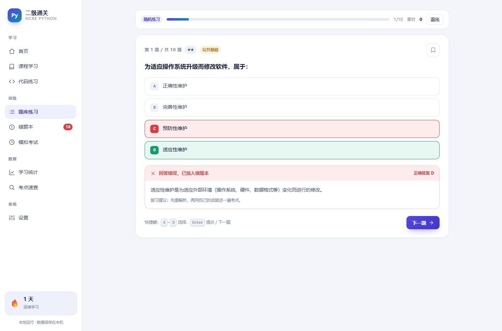
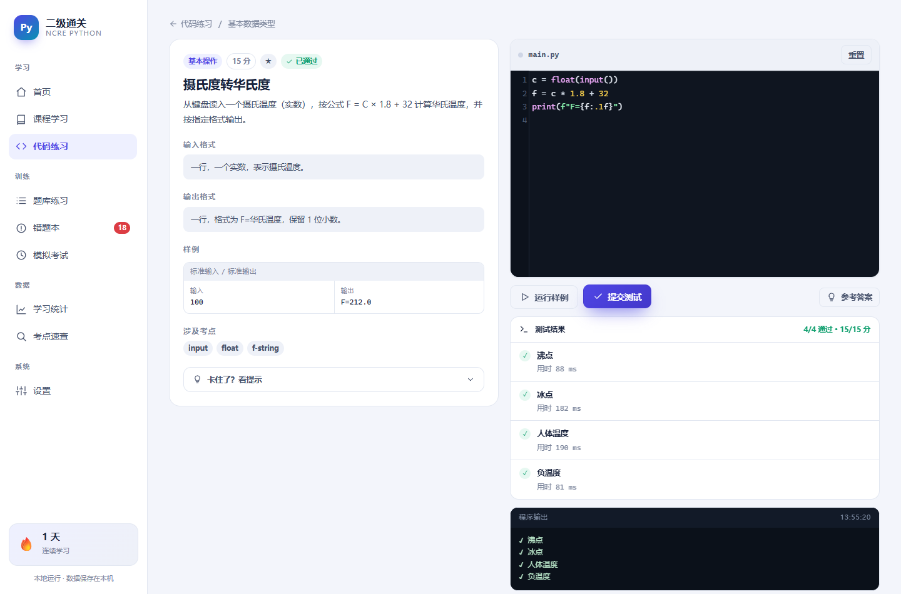
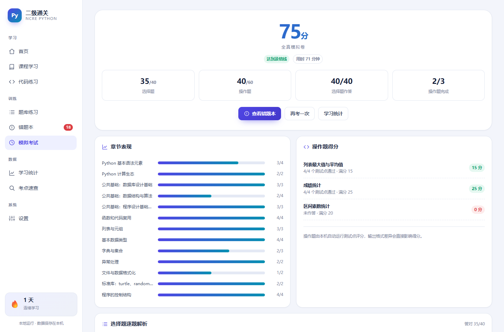
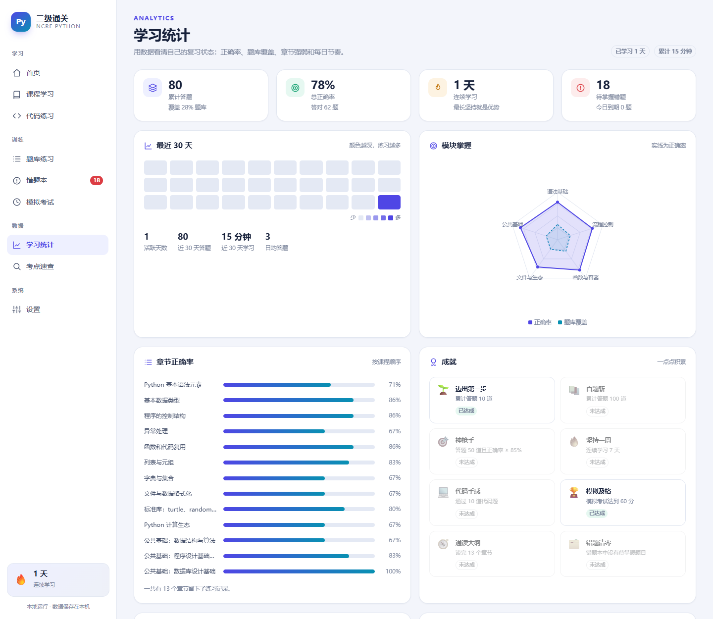

# Python 二级通关

**一个完全离线运行的 NCRE 二级 Python 备考桌面应用。**

13 章课程 · 260 道选择题 · 30 道自动判分编程题 · 错题本 · 模拟考试 · 学习统计

[](LICENSE)
[](LICENSE-CONTENT)
[](#系统要求)



## 功能

- **系统课程**：13 章、223 个内容块，覆盖 Python 语法、流程控制、函数与容器、文件与 CSV、turtle/random/time、第三方库，以及数据结构、软件工程、数据库三门公共基础。
- **可运行示例**：课程中的代码示例可以直接在应用内运行并查看输出。
- **选择题库**：260 道选择题，按章节和难度组卷；每题带解析，答错自动进入错题本。
- **错题本**：按 1 / 2 / 4 / 7 天的间隔安排复习，连续答对两次移出；支持“今日到期”“高频错误”筛选。
- **代码练习**：30 道编程题，分基本操作 / 简单应用 / 综合应用三级；代码在本机子进程运行，逐测试点判分。
- **模拟考试**：全真模拟卷（40 选择 + 3 操作，120 分钟）与考前冲刺卷（30 选择 + 2 操作，60 分钟），交卷自动评分并给出章节分析。
- **学习统计**：30 天热力图、模块雷达图、章节正确率、成就和考试记录。
- **考点速查**：80 条可搜索的语法与公共基础速查。
- **数据自主**：JSON 导出 / 导入、重置进度；支持浅色 / 深色主题；不联网、不上传学习数据。

| 课程学习 | 章节与可运行示例 |
| --- | --- |
|  |  |

| 答题与解析 | 代码自动判分 |
| --- | --- |
|  |  |

| 模拟考试结果 | 学习统计 |
| --- | --- |
|  |  |

## 下载使用

从 [Releases](https://github.com/ROMISUKI/python-level2-tutor/releases) 下载：

```text
PythonLevel2Tutor-v1.0.0-win64.zip
```

解压后运行 `Python二级通关.exe`。首次启动会引导设置考试日期和每日练习目标。

学习数据保存在：

```text
%APPDATA%\PythonLevel2Tutor\progress.db
```

应用只监听 `127.0.0.1` 的随机端口，不向外部网络发送任何内容。

## 系统要求

- Windows 10 / 11（x64）
- 运行发布包：通常无需额外安装，系统自带 WebView2 运行时
- 从源码运行：Python 3.10+

本项目的窗口层使用 pywebview + Edge WebView2，代码执行使用 Windows 子进程与 `taskkill`，因此目前只支持 Windows。

## 从源码运行

```bash
git clone https://github.com/ROMISUKI/python-level2-tutor.git
cd python-level2-tutor

py -3.10 -m venv .venv
.venv\Scripts\activate
pip install -r requirements.txt

python -m app.main
```

也可以只启动本地服务，用浏览器调试前端：

```bash
python -m app.main --server-only --port 8765
```

## 打包 Windows 发布包

```powershell
pip install -r requirements-dev.txt
.\build.ps1
```

默认输出到 `release\`：

```text
release\Python二级通关\Python二级通关.exe
release\PythonLevel2Tutor-v1.0.0-win64.zip
release\PythonLevel2Tutor-v1.0.0-win64.zip.sha256
```

打包使用 **onedir** 模式。编程题判分需要频繁启动 `exe --run-user-code` 子进程；单文件模式每次判分都会重新解包，速度明显更慢。

## 内容维护

课程和题库全部是 JSON，新增内容不需要改 Python 代码：

| 路径 | 作用 |
| --- | --- |
| `content/meta.json` | 模块、考试说明、试卷蓝图（各章抽题数） |
| `content/chapters/chNN.json` | 章节与小节：`text` / `code` / `table` / `tip` / `warn` / `list` / `quiz` |
| `content/questions/qNN.json` | 选择题；`answer` 是正确选项的 0 基下标，`explanation` 必填 |
| `content/exercises/ex_*.json` | 编程题；`tests` 每项包含 `stdin` / `stdout`，可选 `files` 注入测试文件 |
| `content/cheatsheet.json` | 速查条目 |

修改后运行内容校验：

```bash
python tools/validate_content.py
```

校验会检查答案下标、章节引用，并实际执行所有章节代码示例和 30 道编程题的参考答案。

新增大量题目后，可以检查正确选项是否集中在某个字母：

```bash
python tools/rebalance_answers.py          # 预览
python tools/rebalance_answers.py --apply  # 写入
```

脚本会重排选项并同步修改 `answer`。如果某题解析依赖“第一组/第二组”这类选项顺序，需要把题号加入脚本的 `SKIP` 集合。

## 测试

```bash
# 内容 + 代码题
python tools/validate_content.py

# 启动一个使用临时数据的服务
set PYL2_DATA_DIR=%TEMP%\pyl2-smoke
start python -m app.main --server-only --port 8765

# 另一个终端运行接口冒烟测试
python tools/smoke_test.py http://127.0.0.1:8765
```

GitHub Actions 会在 `windows-latest` 上执行内容校验、接口冒烟测试和 PyInstaller 打包。

## 项目结构

```text
python-level2-tutor/
├─ app/                 Python 后端
│  ├─ main.py           入口、pywebview 窗口、子进程运行模式
│  ├─ server.py         本地 HTTP 服务与 API 路由
│  ├─ api.py            答题、错题、考试、统计等业务逻辑
│  ├─ db.py             SQLite 持久化
│  ├─ content.py        题库加载与校验
│  ├─ runner.py         代码执行与测试点判分
│  └─ paths.py          资源与数据目录
├─ content/             课程、题库、代码题、速查（JSON）
├─ web/                 前端（原生 ES Modules + CodeMirror 5）
├─ tools/               内容校验、答案均衡、冒烟测试、图标生成
├─ packaging/           PyInstaller 版本信息
├─ docs/screenshots/    README 截图
├─ licenses/            第三方许可证全文
├─ build.ps1            打包并生成发布 zip
└─ run_app.py           PyInstaller 入口
```

## 数据与隐私

- 学习记录只保存在本机 `%APPDATA%\PythonLevel2Tutor\progress.db`。
- 应用不包含遥测、账号系统或云同步，不会上传课程、题目、代码或学习记录。
- 学生代码在本机独立子进程中运行，设置了超时和输出截断，但**不是对抗恶意代码的安全沙箱**。不要运行来源不明的脚本。
- 自动判分严格比较标准输出（可选浮点容差），输出格式差异会直接影响得分。

## 免责声明

本项目是个人学习工具，**非官方项目**，不隶属于教育部教育考试院或任何考试机构。

题库依据 NCRE 二级 Python 考试大纲编写，为原创练习与解析，**不是历年真题**。考试大纲和题型如有调整，请以官方发布为准。

## 许可证

- **代码**（`app/`、`web/`、`tools/`、`build.ps1` 等）：[MIT](LICENSE)
- **课程与题库内容**（`content/` 及教学说明）：[CC BY-NC-SA 4.0](LICENSE-CONTENT)

你可以自由使用、修改和分发代码；转载或改编课程与题库时，请署名、注明出处、不得用于商业目的，并以相同协议共享。

第三方组件许可见 [THIRD_PARTY_NOTICES.md](THIRD_PARTY_NOTICES.md) 和 [`licenses/`](licenses/)。

## 贡献

欢迎提交题目修正、解析改进和新功能。提交前请先阅读 [CONTRIBUTING.md](CONTRIBUTING.md)，并确保 `python tools/validate_content.py` 通过。
